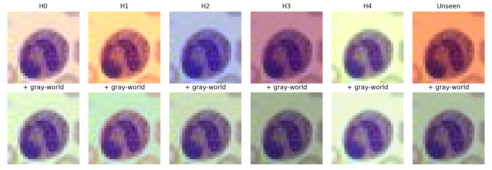
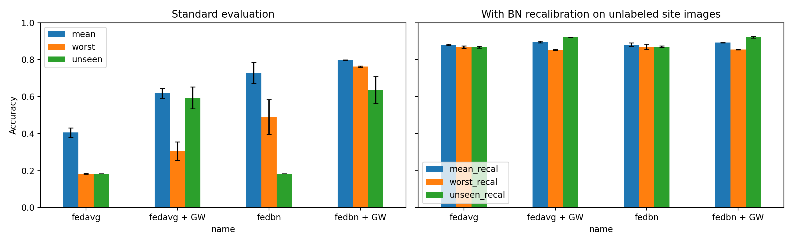

# Why Does Federated Learning Fail Across Hospitals? Batch-Norm Statistics vs. Imaging Shift

**Question:** When hospitals differ in stain color, brightness, and blur, why does federated learning fail, and can cheap, label-free fixes recover performance?

## Setup
- **Data:** BloodMNIST (MedMNIST), 8 blood-cell classes, 28×28 images
- **Hospitals:** 5 simulated clients with the same class mix but different color casts, brightness, and blur, plus 1 unseen hospital (held-out validation split) for out-of-federation testing
- **Model:** small CNN with batch normalization, 15 communication rounds, 1 local epoch, 2 seeds
- **Methods:** FedAvg and FedBN, each with and without gray-world color normalization applied locally at each client
- **BN recalibration:** after training, batch-norm statistics are re-estimated from each site's own *unlabeled* images (no labels used, no data shared)

## Results (mean of 2 seeds)

| Method | Mean | Worst hospital | Unseen | Mean (recal) | Worst (recal) | Unseen (recal) |
|---|---|---|---|---|---|---|
| FedAvg | 0.406 | 0.183 | 0.182 | 0.880 | 0.868 | 0.869 |
| FedAvg + GW | 0.619 | 0.306 | 0.593 | 0.896 | 0.853 | 0.922 |
| FedBN | 0.729 | 0.490 | 0.182 | 0.882 | 0.870 | 0.870 |
| FedBN + GW | 0.798 | 0.763 | 0.636 | 0.892 | 0.855 | 0.922 |

## Findings
1. **FedAvg collapses under imaging shift:** 40.6% mean and 18.3% on the worst hospital. Results of 18.2% correspond to the model predicting a single class.
2. **The failure comes mostly from batch-norm statistics, not learned features.** Re-estimating BN statistics from unlabeled site images raises FedAvg to 88.0% mean, 86.8% worst-hospital, and 86.9% on the unseen hospital.
3. **After recalibration, FedBN gives no advantage over FedAvg** (88.2% vs. 88.0%). Here, FedBN's benefit comes almost entirely from keeping local BN statistics.
4. **Gray-world normalization mainly helps on unseen hospitals:** with recalibration, unseen-hospital accuracy rises from about 87% to 92.2% for both methods, consistently across seeds. On the training hospitals it adds little, and worst-hospital accuracy drops slightly (86.8% → 85.3%).

## Fairness across hospitals
Treating hospitals as groups, equity-scaled accuracy = mean / (1 + Σ|acc_hospital − mean|):

| Method | ES-Acc | ES-Acc (recal) |
|---|---|---|
| FedAvg | 0.206 | 0.847 |
| FedAvg + GW | 0.362 | 0.816 |
| FedBN | 0.449 | 0.844 |
| FedBN + GW | 0.707 | 0.821 |

Without recalibration, gray-world greatly improves fairness across hospitals. After recalibration, it slightly raises mean accuracy but lowers fairness, because it helps easier hospitals while slightly hurting the hardest one.

## Limitations
- Shifts are simulated; images are 28×28; small CNN; 2 seeds; one dataset.
- For the unseen hospital, BN statistics are estimated on the same unlabeled images used for evaluation (standard test-time adaptation). A stricter test would calibrate and evaluate on separate halves.
- Gray-world assumes the average image color is gray, which doesn't hold for stained slides, so it introduces a green tint.

## How to run
Open `fl_blood_cell_heterogeneity.ipynb` in Google Colab and run all cells (CPU, about 1 hour).
